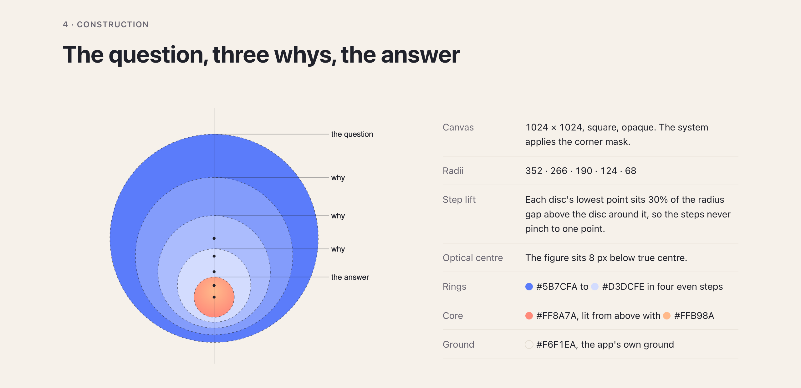
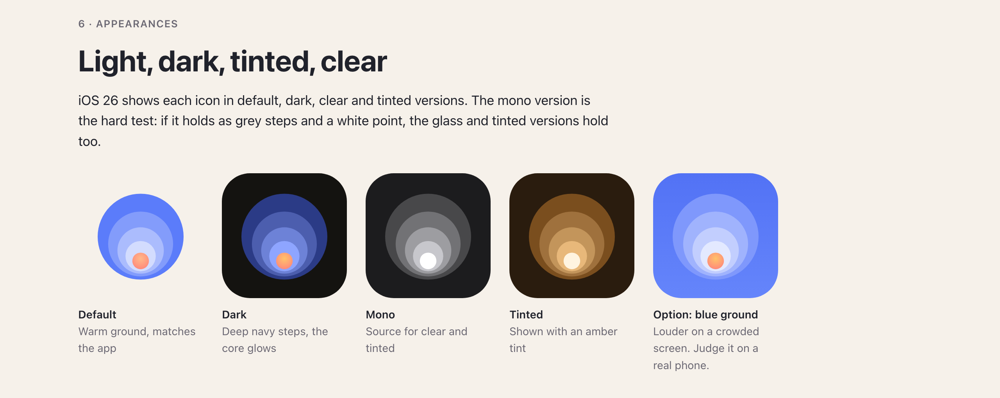

# Logo Studio

A Claude Code skill that designs an original logo for an app, website or business. It studies the real logos of your competitors first, finds what nobody in your field is drawing, and gives you one page with the idea and the evidence. Once you approve a direction, it exports the files for iOS, Android and the web.





*Depth, the icon for the app Big Why, is the project this skill grew from. Five discs step down to one warm core, so every why goes one step deeper. To see the whole page, including the real competitor icons it was judged against, download [big-why.html](docs/examples/big-why.html) and open it in a browser. The skill's own pages follow the same structure.*

## How it works

1. **Brief.** It reads your project, asks at most three questions, and checks the name and what it means.
2. **The field.** It collects real competitor logos from the App Store, Google Play and company websites.
3. **Analysis.** It sorts them by what each one draws, and works out what the field has left open.
4. **Ideas.** It writes at least three ideas before drawing, including one built from the name's own letters.
5. **Drawing.** It draws at least five concepts from scripts, then critiques the renders over at least three rounds.
6. **The page.** It shows the field, the gap, the idea, construction, sizes, colours and the logo in context, then stops for your approval.
7. **Export.** After you approve, it writes source files, app icons and the website favicon set.

## Install

You need [Claude Code](https://claude.com/claude-code) and Node 18 or newer. Nothing else is required. A Chromium browser lets it check the page by eye, and Xcode 26 on a Mac adds a check of the iOS 26 icon.

**Mac or Linux.** Run these three commands:

```bash
git clone https://github.com/tornike14/logo-studio.git
```

```bash
mkdir -p ~/.claude/skills
```

```bash
cp -R logo-studio/logo-studio ~/.claude/skills/logo-studio
```

**Windows.** In PowerShell, run these three commands:

```powershell
git clone https://github.com/tornike14/logo-studio.git
```

```powershell
New-Item -ItemType Directory -Force "$env:USERPROFILE\.claude\skills"
```

```powershell
Copy-Item -Recurse "logo-studio\logo-studio" "$env:USERPROFILE\.claude\skills\logo-studio"
```

You should end up with `.claude/skills/logo-studio/SKILL.md`. Restart Claude Code. To install without git, download `logo-studio.zip` from the [latest release](https://github.com/tornike14/logo-studio/releases/latest) and follow [logo-studio/README.md](logo-studio/README.md).

## Use

Type `/logo-studio` with what you're making:

```
/logo-studio a dog walking app called PawPath
```

Or ask for a logo in your own words. In a code project, it reads your docs first and asks only what it can't find.

## What leaves your computer

There is no telemetry and no account. A run does reach these services:

- **Web search.** Claude searches for your brand name and your category. If the name is unannounced, say so before you start.
- **Apple's Search API.** It sends app names and category terms.
- **Google Play.** It opens the public page of each app listed by package name.
- **Competitor websites.** It reads each site's `robots.txt`, home page and logo images.
- **Google Fonts and GitHub.** It downloads a font when a wordmark uses one.

## How it treats other sites

- Requests to competitor sites identify themselves as `logo-studio`, with a link to this repository, including its screenshots.
- It obeys `robots.txt` and stops at firewall pages. A site that refuses is listed as not collected, and Claude asks you for that logo instead. Apple's results come from its documented Search API, which has its own rate limit, and the tool stays under that limit.
- Names and titles from the web are treated as data. They are cleaned, text that tries to instruct an AI is withheld, and the skill tells Claude never to follow instructions found on a page. This lowers the risk of prompt injection but cannot remove it.

## Good to know

- Uniqueness is checked only against the competitors found. Run a trademark search before you commit to a logo.
- Real competitor logos appear on the page as research. Keep it private, or remove them before publishing it.
- Windows and Mac get the same logo, page and files.

## Development

Only the `logo-studio/` folder ships. The rest of this repository is for building and testing it.

```bash
node tests/general.mjs
```

```bash
node logo-studio/scripts/self-test.mjs --network
```

Leave out `--network` to skip the test that contacts the real services.

This repository does not take contributions. If you want to change the skill, fork it under the MIT licence.

## Licence

[MIT](LICENSE). Third-party files in `logo-studio/vendor/` keep their own licences, listed in [THIRD-PARTY.md](logo-studio/vendor/THIRD-PARTY.md).
